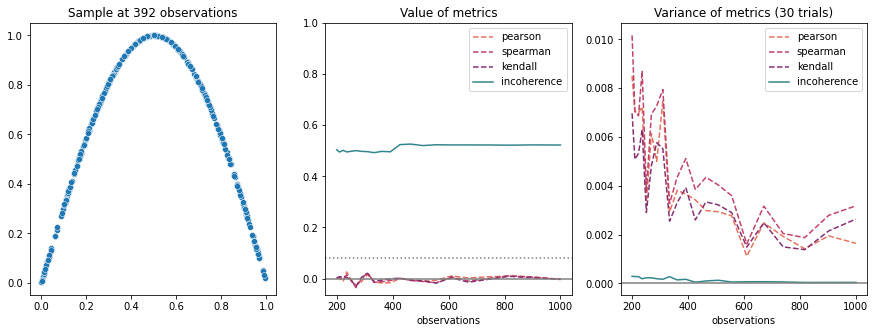

# Work that was not published

This page describes the parts of the repository that are in neither paper.

It says what each piece does, what its saved notes claim and why it was left out.

| Thread | Where it lives | Saved figures |
| :-- | :-- | :-- |
| Incoherence as a correlation measure | `notebooks/correlation_coeff/`, `ensemblepy/correlation.py` | 33 in `figures/` |
| Entropy in more than one dimension | `notebooks/continuous_entropy/`, `ensemblepy/densityvar.py` | 16 beside the notebooks, 2 of them published |
| The wealth model | `notebooks/incoherence/4.1` and `4.2`, `simulations/wealth/` | 9 in `figures/` |
| Movie reviews | `notebooks/incoherence/Movie reviews.ipynb` | None |
| Earlier comparisons with chi² | `notebooks/chi_squared/` | 3 beside the notebooks |
| Side notes for the Cohesion paper | `notebooks/cohesion/` | None |
| Snowflakes and an ideal gas | `simulations/snowflake/`, `simulations/ideal_gas/` | None |

## Incoherence as a correlation measure

The idea was to use incoherence to tell whether `y` depends on `x` in a scatter of points. We
canned it because it did not pan out.

Take a scatter of `x` and `y` points and slice it into vertical strips. Treat the `y` values in
each strip as one trial. If `y` does not depend on `x`, every strip holds the same mix of `y`
values and incoherence is low. If it does, each strip holds a narrower set than the scatter as a
whole and incoherence is high. Nothing about the measure changes. It is pointed at strips of a
scatter where the paper points it at runs of a system.

`ep.Correlation(x, y)` does this. The answer depends on how many strips you cut, so it cuts the
scatter several times and puts every strip in together. It starts at 3 strips and goes up to the
natural log of the number of points, rounded down. For 1,000 points that is 3, 4, 5 and 6 strips.

```python
import numpy as np
import ensemblepy as ep

rng = np.random.default_rng(1)
x = rng.random(1000)

unrelated = rng.random(1000)
line = x + rng.normal(0, 0.05, 1000)
arch = np.sin(np.pi * x)

for name, y in [("unrelated", unrelated), ("line", line), ("arch", arch)]:
    c = ep.Correlation(x, y).correlations()
    print(f"{name:10} pearson={c['pearson']:5.2f}  incoherence={c['incoherence']:.2f}")
```

```text
unrelated  pearson=-0.04  incoherence=0.01
line       pearson= 0.99  incoherence=0.67
arch       pearson=-0.05  incoherence=0.54
```

Pearson and incoherence agree on the first two and split on the arch. `y` rises and then falls,
so the two halves cancel out and Pearson reports nothing. Incoherence sees that each strip holds
a narrow band of `y` and reports a relationship. Spearman and Kendall miss it too.



The left panel is a sample of the data. The middle one is the average of each measure over 30
trials as the number of points grows. The right one is how much each measure varied.

It reads differently from the standard measures in four places.

- **It has no direction.** A rising line and a falling line both read 0.72.
- **A perfect line does not read 1.** It reads about 0.7, so the number is not on Pearson's scale.
- **It has no p-value.** `notebooks/correlation_coeff/Results.ipynb` treats anything over 0.08 as
  a relationship, a level set by eye.
- **Noise pulls it down faster.** On a straight line with noise of 0.7, Pearson reads about 0.4.
  Incoherence reads 0.07, which is under that level.

It was left out of the Incoherence paper so that it did not clutter the main argument. We then
canned the idea, because other measures are already built for curved relationships and they do
the job better.

A later scratch test on simulated data put it up against distance correlation, mutual information
and four others. It lost to distance correlation in 7 of 8 comparisons and won none. Distance
correlation also picks up the arch above more often, 64% of the time at 200 points against 33%
for incoherence. The 0.08 level failed too. With no relationship in 200 points, it raised a false
alarm between 9% and 99% of the time, depending on how `x` was spread. The test is not saved in
this repository.

The notebook has graphs for more shapes, including noisy lines, longer sine waves and the
Datasaurus scatters. It uses "ergodic complexity", an older name for incoherence.

## Entropy in more than one dimension

The entropy estimator works on points in any number of dimensions, not only on a line.
`ensemblepy/densityvar.py` stores its scaling constants for up to four.

`notebooks/continuous_entropy/Dimensional invariance.ipynb` compares it with binned entropy in one
to four dimensions, for three shapes of data. The one dimensional panels became Figures 3 and 4 of
the Cohesion paper. The panels across dimensions, saved as `block-dv.eps`, `perfect-dv.eps` and
`points-dv.eps`, were not published.

The other notebooks in the folder are working notes:

| Notebook | What it does |
| :-- | :-- |
| `Comparison and Invariance plots` | Compares the estimator with standard, normalised and Jaynes entropy, and checks it holds steady as the observations, steps and `k` change |
| `Density approximation` | Looks at the density curve the estimator builds |
| `Cache min max variance` | Makes the constants stored in `CACHED_VS` |

Both papers use one dimension only, and the package left the rest out. Nothing outside these
notebooks used more than one dimension.

## The wealth model

The Boltzmann wealth model has agents who hand money to each other at random. Two notebooks in
`notebooks/incoherence/` use it, and the README already notes that neither made the final paper.

- **`4.1. Disorder - Boltzmann Wealth Distribution`** asks whether disorder alone looks complex.
  Its notes say the standard model stays low at 0.06, and moving 80% of an agent's wealth at a
  time raises that only to 0.08. Giving agents a memory of who they have paid before raises it
  much further.
- **`4.2. Initial conditions - Wealth model`** varies where the money starts. Its notes say the
  plain model begins incoherent and then converges, because every run heads for the same high
  entropy state. With memory, the runs take visibly different paths.

The wealth model made the paper too long, and a reviewer misread it. The published paper makes the
same two points with cellular automata and random graphs, which are clearer. These notebooks use
the older words "ergodic complexity" for incoherence.

## Movie reviews

`notebooks/incoherence/Movie reviews.ipynb` applies the measures to a Rotten Tomatoes dataset. It
groups films by release year and by production company, then compares incoherence with chi²,
ANOVA and Kruskal-Wallis on critic ratings, audience ratings and the gap between them.

It was an experiment, and it was dropped because the results did not feel useful enough. It has
no written notes and saves no figures. The dataset is not in the repository and its source was
not recorded.

## Earlier comparisons with chi²

Two notebooks in `notebooks/chi_squared/` made the published baseline figures: `Discrete
comparison` and `Continuous comparison`. The other four are earlier passes at the same question.

| Notebook | What it does |
| :-- | :-- |
| `ChiSquare measures` | Tests how chi² and incoherence respond to more trials, more observations, more states and different weights. Saved `discrete-uniform.eps`, `discrete-normalised.eps` and `discrete-incremental.eps`. |
| `ANOVA kruska` | Compares incoherence with ANOVA and Kruskal-Wallis as the mean and the spread change |
| `Chi2 comparison` | A short direct comparison |
| `Complex distributions` | The same comparison on less regular distributions |

`ChiSquare measures` uses the names "ergodic complexity" and "Tau2" for what became incoherence.

## Side notes for the Cohesion paper

- **`notebooks/cohesion/Ergodicity.ipynb`** simulates a coin toss game where a win multiplies
  your wealth by 1.5 and a loss by 0.6. It illustrates how the average over many players differs
  from what one player sees over time. It saves no figures. It is the one notebook that ran from
  top to bottom in the check described in [Reproducing the figures](reproducing.md).
- **`notebooks/cohesion/KL vs JS distance.ipynb`** compares Kullback-Leibler and Jensen-Shannon
  divergence on small examples. It imports `ergodicpy`, an older name for `ensemblepy`, so it no
  longer runs.

## Snowflakes and an ideal gas

Two simulations are used by no notebook. Both were used in an early version of the
[Cohesion primer](https://timjdavey.com/cohesion/).

- **`simulations/snowflake/`** generates snowflakes from three settings: the number of spikes,
  how wide they spread and how alike the spikes are.
- **`simulations/ideal_gas/`** is a box of particles that bounce off the walls, built on Mesa.

`simulations/fab/` holds the factory line as a module. `notebooks/incoherence/FAB.ipynb` defines
the same classes inline and does not import it.
